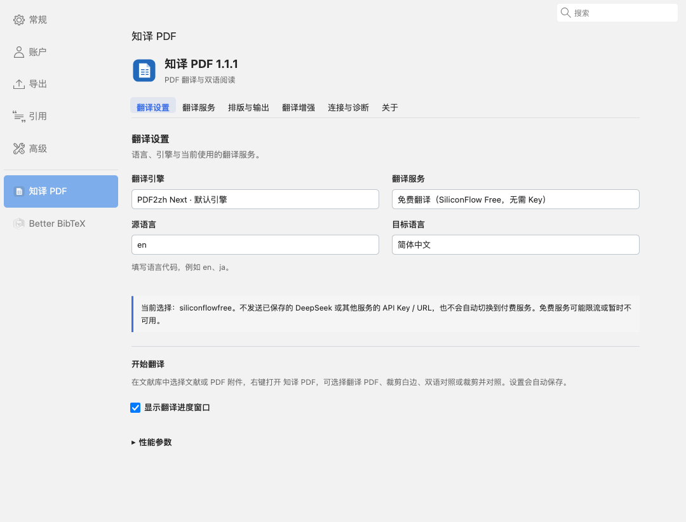

# 知译 PDF（ZhiYi PDF）

**基于 PDF2zh / [zotero-pdf2zh](https://github.com/guaguastandup/zotero-pdf2zh) 生态开发，配合 [PDFMathTranslate-next](https://github.com/PDFMathTranslate-next/PDFMathTranslate-next) 与 [BabelDOC](https://github.com/funstory-ai/BabelDOC) 使用。** 感谢上游作者与贡献者。知译 PDF 是独立维护的兼容实现，不是上游官方版本，也不声称完整复刻上游的所有功能。

在 Zotero 中翻译论文 PDF，生成纯译文与双语对照，并提供跨页段落、术语、列表和表格文字处理。

当前插件版本：**1.1.2**。翻译增强组件：**1.0.5**。本版修复对照、裁剪结果的路径处理及附件入库确认，保持现有翻译算法和默认设置。



## 功能

- 从文献条目或 PDF 附件的右键菜单启动翻译、裁剪白边、双语对照、裁剪并对照。
- 生成纯译文或双语 PDF，支持左右、上下排版，以及完成后打开所选附件。
- 使用免费翻译服务，或配置自己的 DeepSeek、OpenAI 兼容等 API。
- 对识别到的跨页段落联合翻译，并将结果分配回原有页面；支持术语表、数字风格、列表、表格文字和引用符号处理。
- 在设置中管理服务连接、增强组件，查看最近一次任务的处理记录。

设置分为“翻译设置、翻译服务、排版与输出、翻译增强、连接与诊断、关于”六个分区。

## 运行条件

当前实测环境为 **macOS + Zotero 10.0.6**。其他操作系统和 Zotero 版本尚未完成验证。

**XPI 只包含 Zotero 客户端和自有增强组件，不包含完整翻译服务器。** 当前环境准备方式依赖本机已安装的以下环境：

| 组件 | 已验证版本 |
| --- | --- |
| zotero-pdf2zh Server | 4.1.7 |
| pdf2zh_next | 2.9.0 |
| BabelDOC | 0.6.2 |

如果尚未安装后端，请先参照 [zotero-pdf2zh 的安装说明](https://github.com/guaguastandup/zotero-pdf2zh)准备。知译 PDF 的准备脚本只读复制已有环境，不会自动下载并配置完整后端。

## 安装与升级

1. 在 [GitHub Releases](https://github.com/giaogiaogiaoluan/zhiyi-pdf/releases) 中选择 **1.1.2**，下载 `ZhiYi-PDF-1.1.2.xpi`。首次准备服务时，还需要同版本源码 ZIP。
2. 打开 Zotero 的插件管理器，选择 **齿轮 → 从文件安装插件**，选择 XPI。
3. 按 Zotero 提示重启，在“设置 → 知译 PDF → 关于”中确认插件版本为 **1.1.2**。
4. 按下一节准备独立翻译服务，检测连接后开始使用。

已有早期版本的用户直接安装新版 XPI 即可。内部插件 ID、偏好键和增强模块路径继续沿用历史名称，以保留设置和升级关系；因此部分技术路径中仍会出现 `pdf2rea`。插件版本为 1.1.2、增强组件版本为 1.0.5 是正常组合。

## 准备翻译服务

在 macOS 上解压同版本源码 ZIP，双击其中的 **`启动 知译 PDF.command`**。首次运行会从默认位置 `~/zotero-pdf2zh/server` 只读复制服务与引擎到独立目录：

```text
~/.pdf2rea/server
```

准备脚本拒绝覆盖已有目标目录，不复制原版的密钥配置、翻译缓存和已译文档。原版 PDF2zh 可继续使用自己的服务与配置。

如果原服务位于其他位置，在解压后的项目目录执行：

```sh
python3 scripts/setup_runtime.py --source /path/to/zotero-pdf2zh/server
```

已有独立服务会在启动时检查兼容组件。仅在确认属于本插件且没有活动任务时升级重启；无法核实旧进程时会提示先退出独立服务，不会操作原版8890。

准备完成后运行启动入口，在“连接与诊断”中检测默认地址 **`http://127.0.0.1:8891`**。已有独立环境的用户无需重复准备；插件会尝试启动本机服务。增强组件未安装或需要更新时，使用该分区的组件安装按钮。

## 日常使用

1. 在“翻译设置”中选择源语言、目标语言和翻译服务。
2. 在“排版与输出”中勾选所需产物，例如纯译文、左右双语对照。
3. 在文献库中选中原始 PDF，或包含它的文献条目，右键选择 **知译 PDF → 翻译 PDF**。
4. 完成后，所选产物会添加到原文献条目下。修改设置后需重新翻译，已有译文不会自动更新。

### 免费服务与自有 API

两种方式可以随时切换。选择免费服务时，不会附带已保存的其他服务的 API Key，也不会自动切换到付费服务。免费服务的可用性、限流及使用规则由提供方决定；自有 API 按对应提供方的规则计费。

使用自己的 API 时，在“翻译服务”中填写并保存地址、模型和密钥。第三方兼容地址请选择 **OpenAI 兼容**；DeepSeek 专用服务使用其官方接口。API 配置单独保存，不自动读取原版插件的密钥。

翻译内容会交给所选服务处理，请按文档使用要求选择提供方。源码、安装包和公开截图不包含用户文献、配置或密钥。

### 使用边界

跨页识别、表格切分和符号分类依赖 PDF 的文字与版面信息。复杂公式、合并单元格、图像表格和过窄文本框仍可能需要人工检查；识别失败时会保留原文或回退处理。跨页联合翻译及 LLM 术语增强需要相应 LLM 服务，其他服务的能力不同。

处理记录用于定位问题，不能代表翻译准确率。旧 pdf2zh 1.x 环境的自动准备、完整 API 模型发现及多语言设置界面尚未提供。

## 开发

仓库包含插件、增强组件和合成测试，不包含上游服务器、虚拟环境、模型、字体或个人测试论文。

```sh
# 没有真实引擎时：运行源码和协议检查，再构建 XPI
bash scripts/run_tests.sh --skip-wiring
bash scripts/build_xpi.sh --skip-wiring

# 已有独立引擎时：运行包含真实引擎挂接的检查
VENV_PY="$HOME/.pdf2rea/server/zotero-pdf2zh-next-venv/bin/python" bash scripts/run_tests.sh
VENV_PY="$HOME/.pdf2rea/server/zotero-pdf2zh-next-venv/bin/python" bash scripts/build_xpi.sh
```

构建产物为 `dist/ZhiYi-PDF-1.1.2.xpi`。`--skip-wiring` 会跳过真实引擎检查，不能据此宣称完整集成验证通过。目录说明、测试与兼容约定见 [开发说明](docs/development.md)，版本变化见 [更新记录](CHANGELOG.md)。

## 许可证与致谢

本项目按 **GNU Affero General Public License v3.0（AGPL-3.0）** 分发，详见 [LICENSE](LICENSE) 与 [第三方项目及来源说明](THIRD_PARTY_NOTICES.md)。

感谢 [zotero-pdf2zh](https://github.com/guaguastandup/zotero-pdf2zh)、[PDFMathTranslate-next](https://github.com/PDFMathTranslate-next/PDFMathTranslate-next)、[BabelDOC](https://github.com/funstory-ai/BabelDOC) 的作者和贡献者。上游组件及第三方服务继续遵守各自许可和使用规则。
